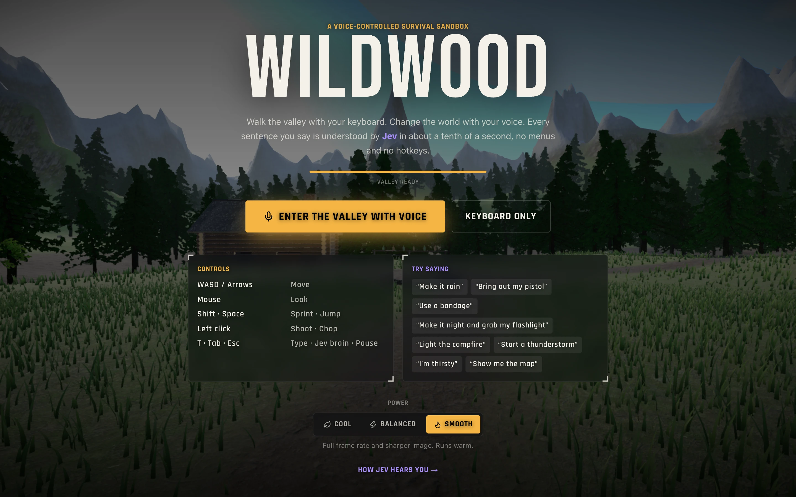
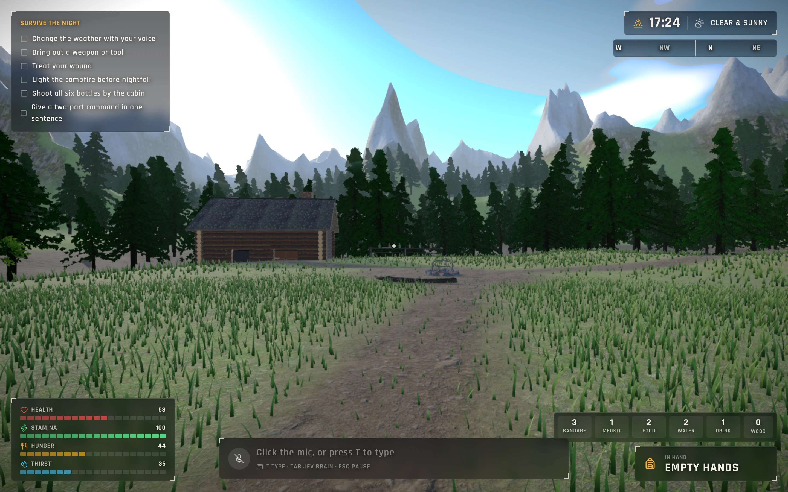
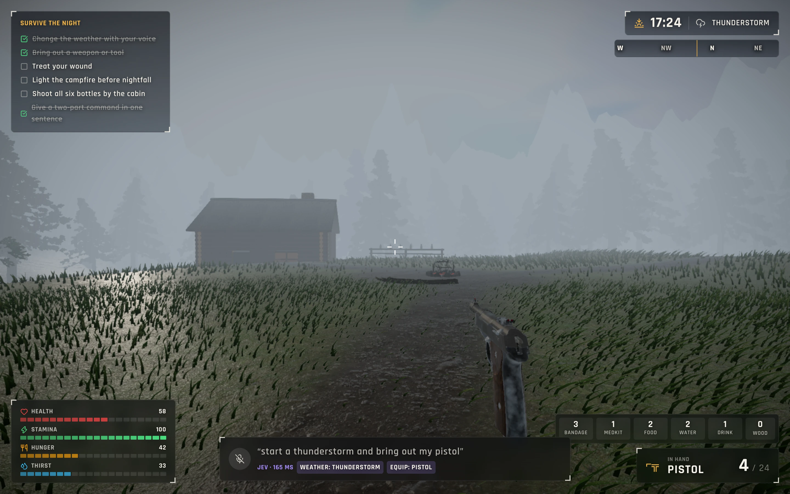
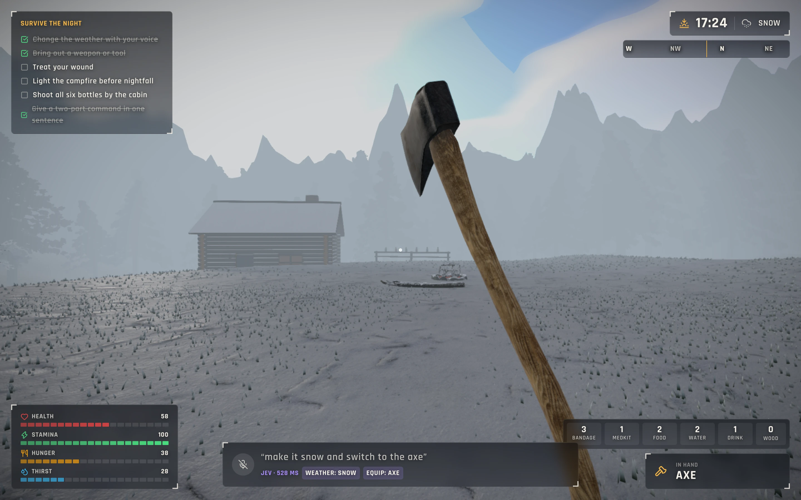
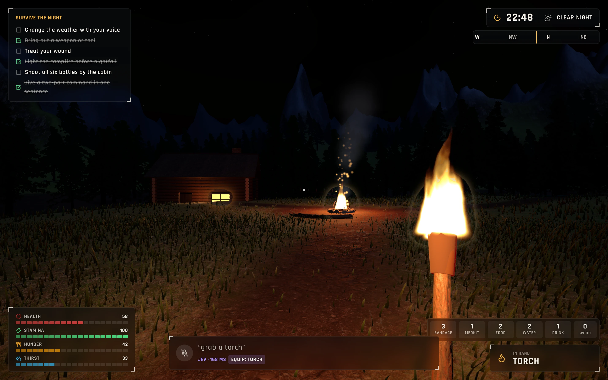
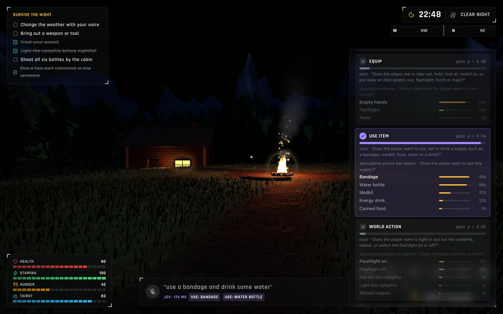

<!-- hero -->
<div align="center">

# Wildwood

**A voice-controlled survival sandbox**

A voice-controlled first-person survival game. Say “make it night and grab my flashlight” and Jev turns it into game actions in about a tenth of a second.

      -7c3aed)



<sub>Title screen over the live valley</sub>

</div>

## Screenshots

| | |
|---|---|
|  |  |
| <sub>Golden hour in the valley</sub> | <sub>“Start a thunderstorm and bring out my pistol”</sub> |
|  |  |
| <sub>“Make it snow and switch to the axe”</sub> | <sub>Night, the campfire lit, a torch in hand</sub> |
|  |  |
| <sub>Jev brain (Tab): every gate and probability for the last sentence</sub> | <sub>How Jev hears you: one sentence, nineteen questions</sub> |

## About

> Full write-up of how the game uses Jev, voice as game input, and how to extend it: [DOCUMENTATION.md](DOCUMENTATION.md).

A first-person forest valley built with Three.js / React Three Fiber where you **walk with the keyboard and change the
world with your voice**. Everything you say goes to **TypeSafe's Jev**, which answers 19 typed questions about the
sentence in one request (~100–200 ms), and plain code turns the answers into game actions.

> “Make it night and grab my flashlight” → Time: Night + Equip: Flashlight
> “Use a bandage and drink some water” → Use: Bandage + Use: Water bottle
> “Let it pour” → Weather: Heavy rain

## Run it

```bash
npm install
cp .env.example .env.local   # add your TYPESAFE_API_KEY
npm run dev                  # http://localhost:3000, best in Chrome (speech recognition)
```

Click **Enter the valley with voice** and allow the microphone. No mic or not on Chrome? Press **T** in game to type
commands instead.

| Key | Action |
| --- | --- |
| WASD / arrows | Move |
| Mouse | Look |
| Shift / Space | Sprint / jump |
| Left click | Shoot (pistol) / chop (axe) |
| T | Type a command |
| Tab | Toggle the **Jev brain** inspector |
| Esc | Pause (voice keeps working) |

## The world

A real-time, photographic-style valley rendered with three.js / React Three Fiber:

- **Terrain**: 1.6 km of ridged-noise mountains around a walkable valley. A splat shader blends photoscanned forest
  floor, bare earth trails, triplanar cliff rock and snow by slope, altitude and a baked ground mask, with two texture
  scales to hide tiling. Rain darkens it and makes it glossy; snow settles on flat ground.
- **Performance**: the canvas renders only when the frame limiter asks (see power modes); local lights exist only while lit (shader variants are pre-compiled on the start screen, so
  switching items never stutters), shadows re-render only when you have walked a few metres, the lake mirror skips
  grass and undergrowth, foliage uses matte Lambert shading, and the cabin's logs are merged into two meshes.
- **Forest**: pines grown procedurally with [ez-tree](https://github.com/dgreenheck/ez-tree) (real bark and needle
  textures, wind sway). About 100 near trees are full meshes with shadows; ~4,700 more become camera-facing impostors
  baked from the same trees at startup, so the mountainsides are forested to the tree line.
- **Grass**: ~480k GPU blades in two layers that wrap around the player, bend in the wind and flatten under snow.
- **Props**: photoscanned rocks, ferns, shrubs, a stone fire pit, a dead-log bench, a brass lantern, and the pistol, axe
  and flashlight you hold, all CC0 from [Poly Haven](https://polyhaven.com) and streamed from their CDN at 1k.
- **Cabin**: built from interlocking bark-textured logs, slate roof, stone chimney and footing, a window that glows at night.
- **Lake**: planar reflections of the sky, mountains and trees, with wind-driven ripples and sun glints.
- **Sky and light**: physical sky with its own lit clouds, image-based lighting regenerated from that sky as the sun moves,
  a shadow-casting sun that follows the player, moon and stars, and fog that matches the horizon.
- **Weather**: GPU rain streaks, snowfall, lightning, overcast and fog, all eased smoothly.
- **Post-processing**: bloom for fire and lamps, ACES tone mapping, FXAA and a soft vignette (ambient occlusion with `?ao=1`).
  `?fx=0` drops post-processing and `?ao=1` adds ambient occlusion.
- **Power modes** (start screen and pause menu, remembered between visits; or `?power=cool|balanced|smooth`):
  | Mode | Moving | Standing still | Menus | GPU per frame* |
  |---|---|---|---|---|
  | Cool | 30 fps | 15 fps | 2 fps | ~5 ms |
  | Balanced (default) | 60 fps | 30 fps | 3 fps | ~7 ms |
  | Smooth | display rate | 60 fps | 6 fps | ~8.5 ms |

  Nothing renders in a hidden tab. *Measured on an Apple M4 at 1440×900 Retina.

Survival vitals (health, stamina, hunger, thirst), supplies, ammo and objectives live in the HUD. All sound is
synthesised with WebAudio. The first load streams roughly 25 MB of models and textures; the start screen shows progress.

## How Jev hears you (`/how`)

This is the **speculative fan-out** pattern from TypeSafe's smart-home demo:

- One yes/no **gate** per command category: weather, time of day, equip, use a supply, world action, plus a status check.
- A **speculative** answer inside every category, asked at the same time: a Choice for weather, time and the item to
  hold; one yes/no per option for supplies and world actions (so several can fire at once).
- Code runs every gate above 0.5, so two-part sentences need no splitting step. Small game rules clean up the rest
  (`src/lib/apply.ts`): don't empty your hands when another command fired, one healing item and one drink per sentence.

The `/how` page lets you type any sentence and shows every gate, every speculative answer, what the game does, the exact
request, and a 60 fps frame budget comparison against an LLM tool call.

## Code map

- `src/lib/commands.ts`: the command vocabulary and the 19 questions
- `src/app/api/command/route.ts`: one Jev request per sentence
- `src/lib/apply.ts`: the rules that turn answers into game effects
- `src/lib/voice.ts`: browser speech recognition, then Jev, then the game
- `src/lib/world.ts`: heightfield, trails, tree/rock/plant placement and the baked ground mask
- `src/components/game/*`: terrain, grass, trees, props, cabin, campfire, lake, atmosphere and weather, effects,
  player controller, held-item view model
- `src/components/hud/*`: HUD, start screen, Jev brain inspector
